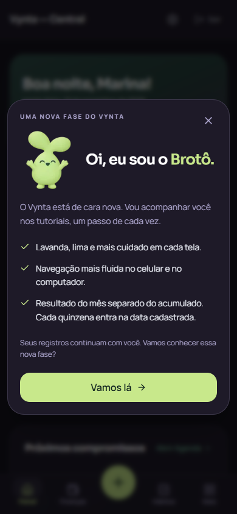

# Brotô — aviso da nova fase

Personagem aprovado, agora chamado **Brotô**. Popup carregado no shell logado,
com abertura discreta, respiro, fechamento por botão/Escape, foco contido e
restaurado, rolagem em telas baixas e movimento reduzido.

Recibo durável por conta + edição, na tabela Notification já existente, com chave
única. O servidor autoriza no máximo uma apresentação, inclusive entre abas e
aparelhos. Recibo criado antes da resposta: uma resposta perdida pode impedir
a apresentação, mas não causar repetição. Não prometer entrega exatamente uma vez
sob falhas. Não apagar recibos enquanto a edição estiver ativa. Sem migração.

Preview Vercel não consome recibo; falhas/offline adiam; tutorial e outros diálogos
têm prioridade. Recibo não entra na fila offline ou no sininho financeiro e não
invalida cache de telas. A imagem é decodificada antes da solicitação.

QA visual: Chrome local com viewport responsiva, build de produção, sessão demo
e endpoint do aviso simulado para não consumir recibo real. Dez combinações:
320/390/430/768/1440 × claro/escuro; 320×568 com botão acessível por rolagem.
Sem overflow horizontal/erros JS. Tab/Escape e reload sem repetição verificados.
Espera por outro diálogo/tutorial ativo e retomada após offline também verificadas.
Movimento reduzido ativado nas capturas. Resultados em `visual-check.json`.

Regressões de serviço/rota em `scripts/check-security.ts`: oito chamadas
concorrentes (uma autorização), conta distinta, falha de armazenamento,
sessão, Origin, identidade do servidor, rate limit e preview sem consumir.
Esses testes são isolados; não alegam teste real em dois dispositivos físicos.

Safari/iPhone físico, teclado nativo e instalação real do PWA não foram testados.
Limitação de ambiente de validação, não defeito confirmado. Não houve deploy.
