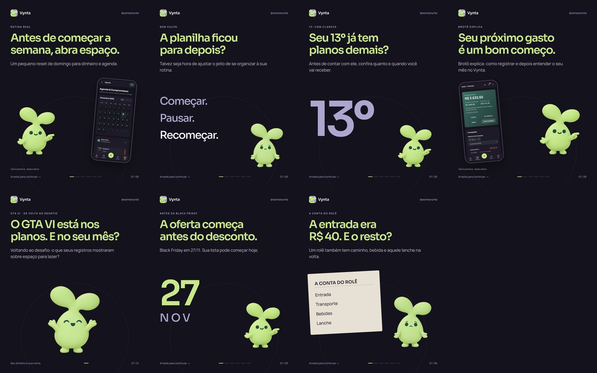

# Pacotes aprovados — Brotô social

Aprovados em 14/11/2026. Os seis posts de 16 a 21/11 substituíram as versões
antigas no Zernio. O anúncio ocupa 15/11 e está em `../15-nova-fase/`.
O reset de domingo ficou como reserva; a data em posts.json é sugestão,
**não agendamento**. Seu ID remoto antigo agora pertence ao anúncio e foi
removido do JSON de reserva para evitar sobrescrever a publicação errada.

Fonte editável: `posts.json` + HTMLs, legendas e roteiros. Cada pasta tem previews
JPG, PNGs locais e stories. As versões efetivamente agendadas de stories ficam em
`story/automaticos/`; as versões manuais com áreas para stickers não foram enviadas.
PNGs completos viajam no ZIP em `marketing/pacotes/`.

IDs/status: `../agendamento-2026-11-15-a-21.json`. Datas: `../CALENDARIO.md`.
Não presumir status remoto a partir de uma data neste JSON de conteúdo.

Para criar outro lote, usar `marketing/templates/broto-social/README.md` e passar
uma pasta nova ao gerador. Não regenerar este lote já agendado sem uma revisão
intencional; editar arquivos locais não altera as mídias já enviadas ao Zernio.

GTA: reconferir a Rockstar em 18 e 19/11. A legenda alternativa retira a data,
sem inventar preço ou alegar parceria. Stories não incluem áudio licenciado.
